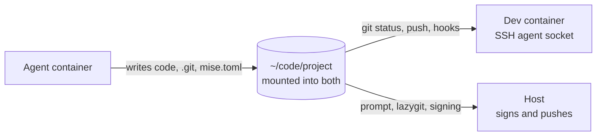
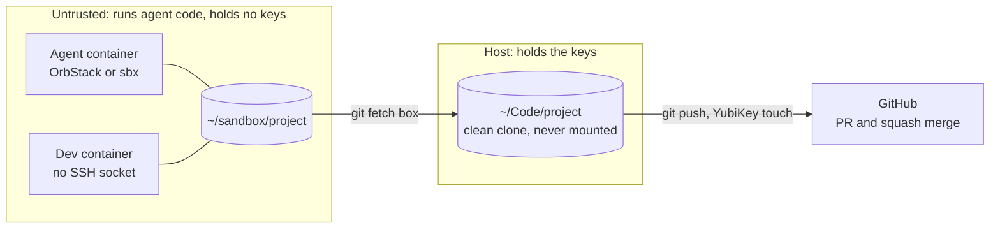

# Dev Container

## About

A Docker development container image with pre-installed tools and utilities, featuring automated CI/CD pipelines, security scanning (Trivy, GitGuardian), multi-architecture builds, and image signing.

## Image Layout

The `Dockerfile` has two stages on the same digest-pinned Debian base:

- **`go-builder`** cross-compiles the Go CLIs (`direnv`, `lazygit`, `fzf`, `shfmt`, `task`) with a pinned Go
  toolchain. It runs on the build host's native platform and targets `$TARGETARCH`, so the arm64 release does not
  compile Go under QEMU.
- **The final stage** installs the tools from `mise.toml`, copies in only the Go binaries, and stows the dotfiles.

Keeping the Go toolchain out of the final image is a security property, not just a size optimisation: its stdlib, test
fixtures and build tools never ship, so they cannot carry vulnerabilities into the image or into the Trivy gate.

### Build Arguments

| Argument       | Default | Purpose                                                                                                                                                                                                 |
| -------------- | ------- | ------------------------------------------------------------------------------------------------------------------------------------------------------------------------------------------------------- |
| `GO_VERSION`   | pinned  | Go toolchain for the `go-builder` stage. The single source of truth for Go; it is deliberately not in `mise.toml`.                                                                                      |
| `DOTFILES_REF` | `main`  | Branch, tag or full 40-char commit SHA of the [dotfiles](https://github.com/leonidgrishenkov/dotfiles). The default follows `main`, so two builds of one commit can differ; pin a SHA to reproduce one. |
| `MISE_VERSION` | pinned  | mise release installed in both stages.                                                                                                                                                                  |
| `APT_REFRESH`  | `local` | Cache key for the apt layer. CI passes the ISO week, so OS packages are re-fetched (with Debian security fixes) at least weekly instead of being reused from the registry cache.                        |

The dotfiles commit an image was built from is printed in the build log and kept in `/etc/devcr-dotfiles-sha`.
Release images also carry it as the `io.github.leonidgrishenkov.devcr.dotfiles.revision` label.

### Building and Checking Locally

```bash
GITHUB_TOKEN=$(gh auth token) docker buildx build \
  --secret id=github_token,env=GITHUB_TOKEN --load -t devcr:local .

# Same gate as CI
trivy image --severity HIGH,CRITICAL --ignore-unfixed --exit-code 1 \
  --ignorefile .trivyignore.yaml devcr:local

# Smoke test, mounted rather than baked into the image
docker run --rm -v "$PWD/scripts/smoke.sh:/opt/smoke.sh:ro" devcr:local bash /opt/smoke.sh
```

## Development With Agents

In this setup an agent never holds keys: the keys stay in 1Password and on a YubiKey, not in files. The boundary that
matters is the project folder an agent shares with you. Through it, above all through `.git`, an agent can get its code
run wherever the keys are: in a dev container with an SSH agent socket, or on the Mac when commits are signed and pushed
there. No container escape is needed:



Of the two, signing and pushing on the host from the same folder is the worse one. The rule that follows: keys live only
where agent code doesn't run, and nothing that runs agent code can write to a `.git` that a trusted environment uses.

### Recommended Layout



1. **Untrusted zone.** The agent and the dev container work together in `~/sandbox/project`, and neither has keys. The
   agent can stay in OrbStack or move to a microVM sandbox such as
   [Docker Sandboxes](https://docs.docker.com/ai/sandboxes/) (`sbx`, set up in
   [docker-sandbox-claude](https://github.com/leonidgrishenkov/docker-sandbox-claude)). Even its direct mode, which
   mounts the folder read-write, fits, because the folder is in the untrusted zone. Don't open that folder on the host:
   a prompt that shows git status already runs `core.fsmonitor`.
2. **Transfer.** Fetch into a clean clone on the host: `git -C ~/Code/project fetch box`, where the remote `box` points
   at `~/sandbox/project`. A current git runs neither the hooks nor the config of the repository it fetches from. Never
   the other way round: `git push box` from the host runs the receiving repository's hooks on the host. The containers
   get a fresh `main` on their own, from GitHub or from a read-only mount of the clean clone.
3. **Review before the push, not before the merge.** Read `git log -p main..box/feat-x` without a checkout, above all
   changes under `.github/`. `pull_request` runs the workflows from the pull request itself, so a changed workflow runs
   with its AWS role as soon as the pull request is opened.
4. **Push without a checkout:** `git push origin box/feat-x:refs/heads/feat-x`. The agent's files never land in the
   host's working copy.
5. **Skip signing.** Squash and rebase merges on GitHub create new commits, so branch signatures never reach `main`,
   and GitHub signs the squash commits itself. No container needs a signing key. If you do want signed branch commits
   for a merge commit, sign in the clean clone on the host with `git rebase -f -S main` through `op-ssh-sign`, where
   1Password shows the real process. That is a checkout, so review changes to `mise.toml`, `.envrc`, `.claude/` and
   `Taskfile` first.

### What Not to Do

- Don't mount one project folder, `.git` included, into an agent's container and into a place that holds keys: a dev
  container with the SSH agent socket, or the host.
- Don't sign or push on the host from the folder an agent writes to.
- Don't forward the SSH agent into a container that runs agent code or code an agent wrote, tests and `npm i` included.
- Don't open the agent's folder on the host with a git-aware prompt, lazygit or an IDE.
- Don't `git push` from the host into the agent's repository.
- Don't give any container `docker.sock` or `--privileged`.
- Don't give an agent a GitHub token with the Workflows permission.

### What Runs Code From a Shared Folder

An agent writes not only code but also files that run later without you:

- **`.git/config`:**
  - `core.fsmonitor` runs on every `git status`, and the starship or fish prompt runs `git status` on `cd`, as do
    lazygit and IDEs.
  - `core.sshCommand` runs on push and sees the SSH agent.
  - `gpg.ssh.program` replaces the signing program. It fires exactly when you expect a 1Password prompt and approve it
    without looking.
  - Also `core.pager`, `core.hooksPath` and `include.path`.
- **`.git/hooks/*`**, which neither `git status` nor `git diff` shows.
- **Project files that tools run on their own:**
  - `mise.toml` with `[env] _.source`. mise trusts a file's path, not its content, so an edit to an already trusted
    file goes through without a prompt.
  - `Taskfile`, `package.json` scripts and `.envrc`.
  - `compose.dev.yaml`: the next `docker compose up` starts whatever was added (`privileged`, a mount of `~`).
  - `.claude/settings.json` (hooks) and `.mcp.json`, when Claude Code runs on the host in that folder.

`safe.directory` doesn't help: OrbStack shows files created in a container as owned by you.

### The SSH Agent Socket

- The socket doesn't hand out the key, but whatever reaches it can use the key: sign a Verified commit in your name in
  any repository, or log in to a server.
- You edit in the dev container because it has the libraries, so the agent's code runs next to the socket: tests,
  `npm i`, `task`. Even without that, language servers and formatters in nvim run project config: `eslint.config.js`,
  `prettier.config.js` and `build.rs` are code. A dev container that shares the agent's folder deserves no more trust
  than the agent's own.
- Run `ssh-add -l` inside a container to see which keys it really gets. The 1Password SSH agent offers every key from
  the vaults its `agent.toml` allows. If server keys are among them, this is not only about GitHub: SSH access to a
  Docker host, such as a docker context over SSH, is effectively root on it.
- With the 1Password agent forwarded, the approval prompt most likely names OrbStack, not the process in the container.
  Approve once, and everything that sees the socket can use the key until 1Password locks. The system `ssh-agent` asks
  nothing at all.
- A push from the host with a hardware key (a YubiKey `ed25519-sk` key with `IdentityAgent none`) needs a touch every
  time; a push from a container goes through an agent key without one.

### OrbStack Specifics

- All containers run in one VM and share its kernel. An agent that escapes its container lands next to the dev
  container and its socket. A microVM sandbox (`sbx`) gives the agent a kernel of its own.
- `docker.sock` or `--privileged` in any container gives access to every file on the Mac, since OrbStack can mount any
  path. A line added to `~/.config/fish/config.fish` or a file dropped into `~/Library/LaunchAgents` then runs on the
  host.
- Containers reach services listening on the Mac's localhost through `host.docker.internal`.
- `devel` has passwordless `sudo` (`NOPASSWD`), so an agent can lift any restriction set up inside the container
  (iptables, managed settings). Restrict the network from outside, as `sbx` does.

## CI/CD Workflow

This project uses a **branch-gated CI/CD pipeline** that avoids running heavy jobs where they are not needed. All
workflows are self-contained in this repository under `.github/workflows/`.

### Workflow Triggers

| Trigger                          | Workflow           | What runs                                                                                                                                                                                              | Purpose                          |
| -------------------------------- | ------------------ | ------------------------------------------------------------------------------------------------------------------------------------------------------------------------------------------------------ | -------------------------------- |
| Push to any branch except `main` | `feature.yml`      | `hadolint` Dockerfile lint, Trivy config scan, `actionlint`, GitGuardian secret scan                                                                                                                   | Fast feedback during development |
| PR into `main`                   | `pr.yml`           | Build amd64 image, Trivy scan (HIGH/CRITICAL, `.trivyignore.yaml`), SARIF upload, `scripts/smoke.sh`                                                                                                   | Gate — must pass before merge    |
| Push tag `*.*`                   | `release.yml`      | Verify tag is on `main`, wait for approval (`release` environment), pin the dotfiles commit, build multi-arch (`linux/amd64`, `linux/arm64`), push to private ECR, SBOM + SLSA provenance, cosign sign | Release                          |

Dependency update PRs come from Renovate, not from a workflow here (see [Dependency Updates](#dependency-updates)).

### Design Goals

- **No heavy jobs on dev branches.** Only lint runs while developers iterate.
- **No duplicate scanning on release.** The PR gate scans an amd64 build of each change; the tag workflow goes straight
  to multi-arch build and push. The published image is a separate build and isn't scanned before the push.
- **No external reusable workflows.** All logic is inlined in this repo for full control.
- **One-way cache sharing.** PR builds reuse the release build cache but write their own, so pull request code can't
  plant layers in a release (see [Cache Strategy](#cache-strategy)).


### Security Checks

- **GitGuardian Scan** (part of `feature.yml`) — runs on every push to any branch except `main` to detect leaked
  secrets.
- **Trivy Image Scan** — runs during PR gate with severity `HIGH,CRITICAL` and `ignore-unfixed: true`, using the
  suppressions in `.trivyignore.yaml` (see [Vulnerability Policy](#vulnerability-policy)). Findings are uploaded to
  GitHub Code Scanning alerts.
- **Smoke Test** — `scripts/smoke.sh` asserts that every `mise.toml` tool and Go CLI runs, the dotfiles are stowed,
  nvim plugins are restored and start cleanly, the user and shell are right, and the Go toolchain is absent.
- **Tag Origin Verification** — the release workflow verifies that the pushed tag points to a commit that is an ancestor
  of `main`. This catches mistakes, not attacks: a tag runs the `release.yml` of the commit it points to, which may not
  have the check.
- **Release Approval** — the release job runs in the `release` environment, which deploys only tags matching `*.*` and
  waits for a required reviewer; `gha-devcr-release` trusts only this environment. Approve a run only for a tag you just
  pushed yourself: a tag on any other commit asks for the same approval.
- **Image Signing** — every release image is signed with **cosign** using keyless OIDC via GitHub Actions.
- **Immutable Release Tags** — published `devcr` tags can't be overwritten. A release pushes only the version tag and
  the commit-SHA tag; there is no moving `latest`, so pull a version. A failed release can't be re-run as is (delete
  its tags first), and a second version tag on an already released commit fails on the commit-SHA tag.

### Vulnerability Policy

The Trivy gate fails on any fixable `HIGH` or `CRITICAL` finding. Findings fall into two buckets:

- **Fixed, never suppressed:** the base OS packages, `curl`, `git`, `gnupg`, OpenSSL, the Go stdlib, anything in a
  TLS/crypto path, and anything that parses untrusted network input. The fix is to bump the package, the toolchain
  (`GO_VERSION`) or the tool. When the tool has no release with the fix yet, the vulnerable dependency is patched in the
  `Dockerfile` until it does (a Go CLI's module in `go-builder`, a package bundled with npm). If no fix exists, that
  blocks the release.
- **Suppressed with justification:** dev tools driven interactively by the single trusted user of the container, and
  their vendored dependencies, when the finding is not exploitable here and no upstream release fixes it (or the fix
  belongs to another repo).

Every suppression in `.trivyignore.yaml` is scoped with `paths` (so the same CVE in an OS package or another tool still
fails the gate), carries a `statement` saying why it is not exploitable here, and has an `expired_at` date about six
months out. Expiry is intentional pressure: when an entry expires the finding reappears and the gate fails, so the
decision is revisited deliberately rather than left to rot. Before extending a date, check whether an upstream release
now makes the entry unnecessary.

Use Trivy's key `expired_at`; an unknown key such as `expired-at` is silently ignored and the entry never expires. In
CI, `limit-severities-for-sarif: true` keeps the gate at `HIGH,CRITICAL`; without it `trivy-action` drops the severity
filter whenever the output format is SARIF.

### Dependency Updates

[Renovate](https://docs.renovatebot.com/) (the hosted Mend Renovate GitHub App, configured in `.github/renovate.json5`)
opens update PRs on Monday mornings (UTC) and keeps a **Dependency Dashboard** issue that lists everything it tracks:

| What                                                              | Where                                           | PR       |
| ----------------------------------------------------------------- | ----------------------------------------------- | -------- |
| Debian base image: newer dated `trixie-*-slim` tag and its digest | both `FROM` lines in `Dockerfile`               | own      |
| GitHub Actions and runner images                                  | `.github/workflows/*.yml`                       | grouped  |
| Tools in `mise.toml`                                              | `mise.toml`                                     | grouped  |
| Go CLIs (`direnv`, `lazygit`, `fzf`, `shfmt`, `task`)             | `TOOLS` in the `go-builder` stage               | grouped  |
| `MISE_VERSION`, `GO_VERSION`                                      | `Dockerfile` ARGs under a `# renovate:` comment | one each |
| Trivy used by the CI scans                                        | `.github/actions/install-trivy/action.yml`      | own      |

- Major updates get a PR of their own. A Go CLI major is only listed on the dashboard for approval: it also changes the
  module path (`/v2` → `/v3`), which has to be edited by hand.
- Renovate PRs come from branches of this repository, so they get its secrets and run the full `pr.yml` gate (build,
  Trivy, smoke test).
- Closing a Renovate PR without merging it ignores that version.
- To track another pinned version in the `Dockerfile`, put `# renovate: datasource=<datasource> depName=<name>` on the
  line right above its `ARG NAME=<version>`.

### Secrets & Variables

| Name                   | Type   | Source                         | Purpose                                                                                                        |
| ---------------------- | ------ | ------------------------------ | -------------------------------------------------------------------------------------------------------------- |
| `AWS_PR_ROLE_ARN`      | secret | `secrets.AWS_PR_ROLE_ARN`      | IAM role for `pr.yml` (GitHub OIDC): read the release cache, read/write the PR cache                           |
| `AWS_RELEASE_ROLE_ARN` | secret | `secrets.AWS_RELEASE_ROLE_ARN` | IAM role for `release.yml` (GitHub OIDC, `release` environment): push to `devcr`, read/write the release cache |
| `GITHUB_TOKEN`         | secret | auto-provided                  | Authenticated GitHub API requests for `mise` package downloads                                                 |

The ECR repositories and the roles live in the infra repository (`cloud/aws/live/us-east-1/container/ecr/devcr`,
`container/ecr/buildcache/devcr`, `container/ecr/buildcache/devcr-pr` and `iam/ecr/devcr`); the secrets are that unit's
`pr_role_arn` and `release_role_arn` outputs. `gha-devcr-pr` trusts pull requests of this repository; it reads the
release cache and writes only the PR cache, so pull request code can't change published images or what a release builds
from. `gha-devcr-release` trusts only jobs in the `release` environment. The role ARNs are secrets rather than
variables, and the workflows mask the account ID, so neither shows up in this public repository's logs.

### Cache Strategy

Builds reuse layers through **registry caches**, each in a private ECR repository of its own (tag `latest`). The image
repository `devcr` has immutable tags, so the moving cache tags can't live there. Each cache repository's lifecycle
policy expires the untagged cache manifests that every build leaves behind after 7 days.

- **Release build** (`release.yml`) reads and writes `buildcache/devcr`, the release cache.
- **PR build** (`pr.yml`) reads the release cache and `buildcache/devcr-pr`, and writes only `buildcache/devcr-pr`.

Trust flows one way because BuildKit reuses a cached layer without checking how it was built: whoever can write a cache
can plant a layer that a later build ships as is. Pull requests run unmerged code, so they write a cache that no release
reads, the same isolation GHA cache (`type=gha`) gives pull requests; a poisoned PR cache can only skew other PR builds.
The cost is that a release doesn't reuse what its PR built: it reuses the layers of the previous release and rebuilds
the rest.

Cached layers never pick up Debian security updates on their own, because nothing in the apt layer's cache key changes
when Debian ships them. Both workflows therefore pass the ISO week as `APT_REFRESH`, which rebuilds the apt layer and
everything after it at least once a week.

The release build passes the resolved dotfiles commit as `DOTFILES_REF`, so a cached dotfiles layer is reused only if it
was built from that exact commit.

## TODO

- [ ] **Scan the release image before it gets tags.** The PR gate scans an amd64 build of the change, but the published
  multi-arch image is a separate build that nothing scans before the push. Push it by digest only (`push-by-digest`),
  run Trivy against `devcr@<digest>` for each platform, and only then add the version and commit-SHA tags and sign it.
  An image that fails the scan stays untagged, and the repository's lifecycle policy expires it after 7 days.
- [ ] **Pin GitHub Actions to commit SHAs.** The workflows reference actions by tag (`docker/build-push-action@v7`), so
  whoever moves a tag runs their code with the job's credentials: in `release.yml`, the release role and the OIDC token
  that cosign signs with. Pin full SHAs with the version in a comment, starting with `release.yml`, and let Renovate
  keep them current (`helpers:pinGitHubActionDigests`).
- [ ] **Rebuild the apt layer when Debian ships fixes, not only weekly.** `APT_REFRESH` is the ISO week, so a security
  fix released mid-week stays behind the cached apt layer until Monday, and the Trivy gate fails every PR until then
  unless the caches are deleted by hand (as with CVE-2026-109518 in apt). Add a hash of the `Packages` entries in
  `trixie-security`'s `InRelease` to `APT_REFRESH` next to the week, so the first build after a security update
  rebuilds the layer.
